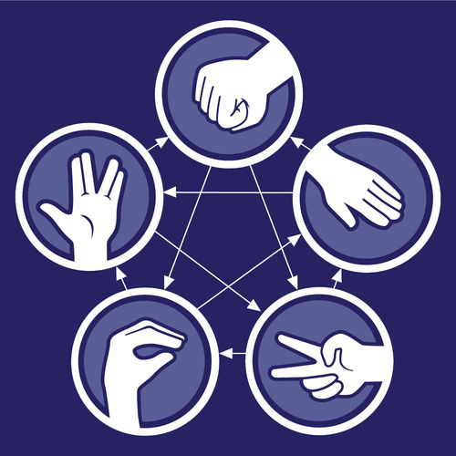
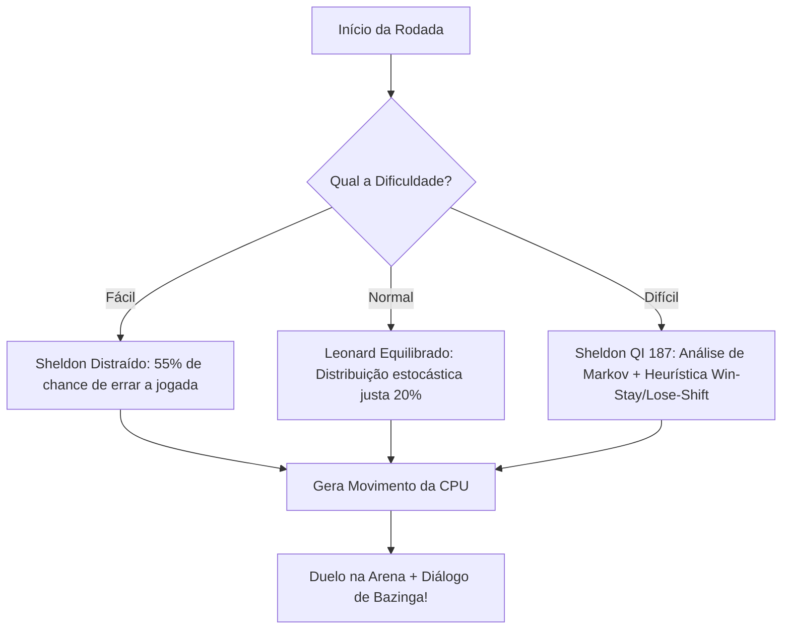

# ⚛️ Bazinga! — Pedra, Papel, Tesoura, Lagarto e Spock

<div align="center">
  
  <br/>
  <p><strong>Uma batalha quântica de mentes inspirada na aclamada série <em>The Big Bang Theory</em>!</strong></p>

  <p>
    
    
    
    
  </p>
</div>

---

## 📌 Sumário
- [Sobre o Jogo](#-sobre-o-jogo)
- [Regras Canônicas do Dr. Sheldon Cooper](#-regras-canônicas-do-dr-sheldon-cooper)
- [Destaques e Funcionalidades](#-destaques-e-funcionalidades)
- [Engenharia da CPU e Níveis de Dificuldade](#-engenharia-da-cpu-e-níveis-de-dificuldade)
- [Design Responsivo e Fluidez](#-design-responsivo-e-fluidez)
- [Arquitetura do Projeto](#-arquitetura-do-projeto)
- [Como Executar o Projeto](#-como-executar-o-projeto)
- [Roadmap de Futuras Atualizações](#-roadmap-de-futuras-atualizações)
- [Licença e Autoria](#-licença-e-autoria)

---

## 🛸 Sobre o Jogo

Criado originalmente por Sam Kass e Karen Bryla e imortalizado pelo Dr. Sheldon Cooper na sitcom **The Big Bang Theory**, o clássico jogo *Pedra, Papel, Tesoura, Lagarto e Spock* reduz drasticamente a probabilidade de empates ao expandir as opções estratégicas de 3 para 5 variáveis.

Nesta implementação desenvolvida em **Flutter**, você tem a oportunidade de desafiar o **Sheldon Bot** em uma disputa melhor de 5 pontos, enfrentando desde uma CPU casual até uma inteligência tática preditiva de alta eficiência.

> *"Tesoura corta papel, papel cobre pedra, pedra esmaga lagarto, lagarto envenena Spock, Spock esmaga tesoura, tesoura decapita lagarto, lagarto devora papel, papel refuta Spock, Spock vaporiza pedra e, como sempre, pedra quebra tesoura."*  
> — **Dr. Sheldon Cooper**

---

## 📜 Regras Canônicas do Dr. Sheldon Cooper

Cada movimento vence exatamente duas alternativas e é derrotado por outras duas:

| Elemento | Ícone | Vence (Ação / Verbo) | Vence (Ação / Verbo) | É Derrotado Por |
| :--- | :---: | :--- | :--- | :--- |
| **Tesoura** | ✂️ | **Corta** Papel | **Decapita** Lagarto | Pedra, Spock |
| **Papel** | 📜 | **Cobre** Pedra | **Refuta** Spock | Tesoura, Lagarto |
| **Pedra** | 🪨 | **Esmaga** Lagarto | **Quebra** Tesoura | Papel, Spock |
| **Lagarto** | 🦎 | **Envenena** Spock | **Devora** Papel | Pedra, Tesoura |
| **Spock** | 🖖 | **Esmaga** Tesoura | **Vaporiza** Pedra | Lagarto, Papel |

---

## ✨ Destaques e Funcionalidades

- 🧠 **Três Níveis de Dificuldade**: Ajuste a inteligência da CPU entre os modos *Fácil*, *Normal* e *Difícil* a qualquer momento da partida.
- 💬 **Diálogos Oficiais de Sheldon Cooper**: A CPU interage em tempo real com falas cômicas da série, comemorando vitórias com *"Bazinga!"* ou justificando derrotas como *"anomalias quânticas"*.
- ⚔️ **Arena de Duelo com Suspense**: Animação de suspense e contagem de cálculo antes da CPU revelar sua jogada.
- 🎯 **Explicação da Regra em Tempo Real**: Feedback textual imediato da razão da vitória ou derrota (ex: *"Spock vaporiza Pedra!"*).
- 📱 **Design 100% Responsivo**: Prevenção ativa de erros de tela (*overflow*), funcionando perfeitamente em telas de qualquer tamanho, proporção ou orientação.
- 🎨 **Estética Cósmica & Neon**: Gradientes escuros com visual galáctico, efeito *glow* nos cards e micro-animações táteis em todos os botões.
- 📖 **Manual de Regras Interativo**: Tela dedicada com filtros dinâmicos por elemento para consulta rápida durante o jogo.

---

## 🧠 Engenharia da CPU e Níveis de Dificuldade

O motor de IA da CPU ([`CpuAiService`](lib/services/cpu_ai_service.dart)) utiliza modelos matemáticos e heurísticas comportamentais:



1. **Fácil (Sheldon Distraído)**:
   - A CPU comete erros frequentes (em 55% dos casos, seleciona um elemento que perde propositalmente para o jogador), sendo ideal para novos participantes.
2. **Normal (Leonard Equilibrado)**:
   - Distribuição de probabilidade uniforme (20% para cada elemento), sem vantagens ou desvantagens, com proteção contra repetições repetitivas consecutivas.
3. **Difícil (Sheldon QI 187 - Bazinga Master!)**:
   - **Cadeia de Markov**: Mapeia o histórico de transições de jogadas do jogador.
   - **Psicologia Humana (Win-Stay, Lose-Shift)**: Explora a tendência humana de repetir escolhas vencedoras e trocar após derrotas para antecipar o próximo passo do oponente.
   - **Margem de Incerteza**: 20% de estocasticidade para garantir que o jogo continue emocionante e imprevisível.

---

## 🎨 Design Responsivo e Fluidez

O aplicativo foi projetado com práticas modernas de UI/UX em Flutter:

- **Layout Seguro Anti-Overflow**: Estruturação com `LayoutBuilder`, `SingleChildScrollView`, `ConstrainedBox` e `FittedBox`.
- **Animações Fluidas**:
  - `AnimatedScale` para feedback elástico de toque.
  - `AnimatedSwitcher` com `ScaleTransition` para atualização fluida do placar.
  - Pulso suave de respiração no logotipo da tela inicial.
- **Paleta Temática Cósmica**:
  - Azul Profundo Cósmico (`#140E36` e `#272362`)
  - Vermelho Bazinga (`#E52521`)
  - Dourado / Flash (`#FFD166`)
  - Acentos Neon específicos para cada um dos 5 elementos.

---

## 🏛️ Arquitetura do Projeto

```
lib/
├── main.dart                      # Ponto de entrada, orientação e AppTheme
├── models/
│   ├── game_move.dart             # Enum dos 5 movimentos, regras e verbos
│   └── game_difficulty.dart       # Enum de dificuldades (Fácil, Normal, Difícil)
├── services/
│   └── cpu_ai_service.dart        # IA preditiva da CPU e diálogos de Sheldon
├── theme/
│   └── app_theme.dart             # Cores cósmicas, gradientes, sombras e ThemeData
├── widgets/
│   ├── bazinga_button.dart        # Botão com escala elástica e gradientes
│   ├── move_card.dart             # Card circular do movimento com borda neon
│   ├── difficulty_selector.dart   # Seletor interativo em formato card/pill
│   └── battle_arena.dart          # Arena animada de duelo (Você vs Sheldon)
└── screens/
    ├── home_page.dart             # Menu principal com seleção de dificuldade
    ├── start_game.dart            # Arena principal da partida com placar dinâmico
    ├── rules_page.dart            # Tela com AppBar temático e regras
    ├── item_rules.dart            # Lista de regras interativa com filtros
    ├── winner.dart                # Tela de vitória (Troféu e estatísticas)
    ├── over.dart                  # Tela de derrota (GameOver e revanche)
    └── select_icon.dart           # Componente auxiliar de ícones
```

---

## 🚀 Como Executar o Projeto

### Pré-requisitos
Certifique-se de ter instalado em seu ambiente:
- [Flutter SDK](https://flutter.dev/docs/get-started/install) (versão 3.x ou superior)
- [Dart SDK](https://dart.dev/get-dart) (versão 3.x ou superior)
- Um dispositivo físico, emulador configurado (Android/iOS) ou navegador (Chrome).

### Passo a Passo

1. **Clone o repositório:**
   ```bash
   git clone https://github.com/jeffBrito/jogoBazinga.git
   ```

2. **Acesse o diretório do projeto:**
   ```bash
   cd jogoBazinga
   ```

3. **Instale as dependências:**
   ```bash
   flutter pub get
   ```

4. **Verifique se há inconformidades no código:**
   ```bash
   flutter analyze
   ```

5. **Inicie o aplicativo:**
   ```bash
   flutter run
   ```

---

## 🗺️ Roadmap de Futuras Atualizações

- [ ] 🌐 **Modo Multiplayer Online**: Batalhas em tempo real contra amigos via WebSocket/Firebase.
- [ ] 🔊 **Efeitos Sonoros & Voz**: Falas narradas de Sheldon Cooper dizendo *"Bazinga!"* e efeitos sonoros para cada ação.
- [ ] 🏆 **Sistema de Conquistas (Achievements)**: Troféus desbloqueáveis ao derrotar Sheldon no modo Difícil sem sofrer pontos.
- [ ] 📊 **Histórico e Estatísticas Globais**: Registro de taxa de vitórias, elementos mais utilizados e gráficos de desempenho.

---

## 📄 Licença e Autoria

Desenvolvido com dedicação por **[Jefferson Brito](https://github.com/jeffBrito)**.  
Inspirado na icônica criação de *Sam Kass*, *Karen Bryla* e na série *The Big Bang Theory* (Warner Bros. / Chuck Lorre Productions).

<div align="center">
  <br/>
  <strong><em>"Que a física teórica esteja sempre a seu favor! BAZINGA! 🖖"</em></strong>
</div>
